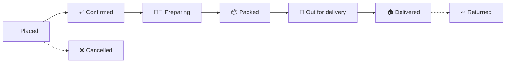
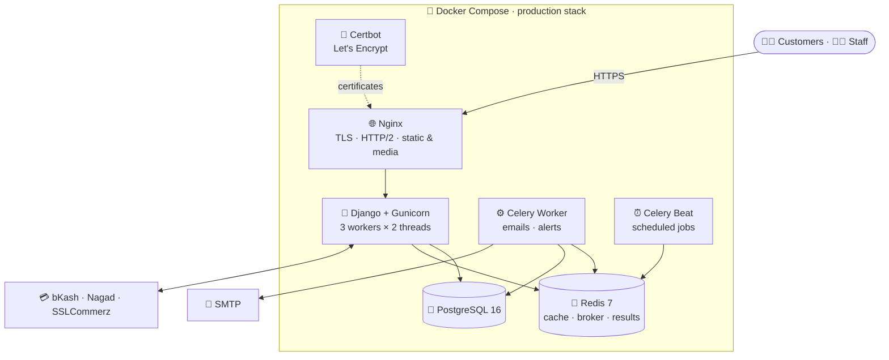
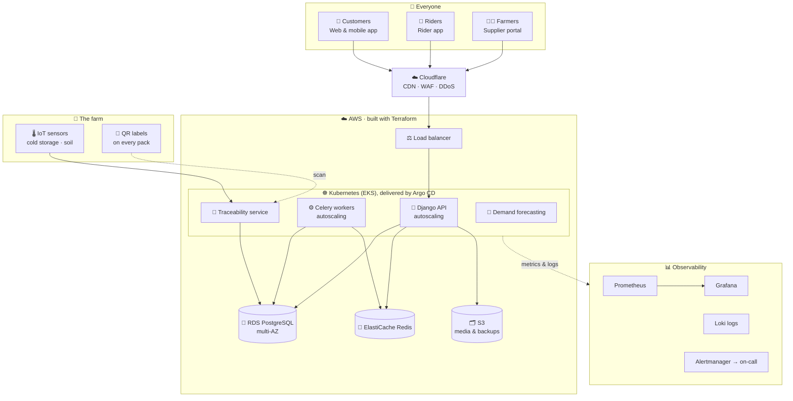
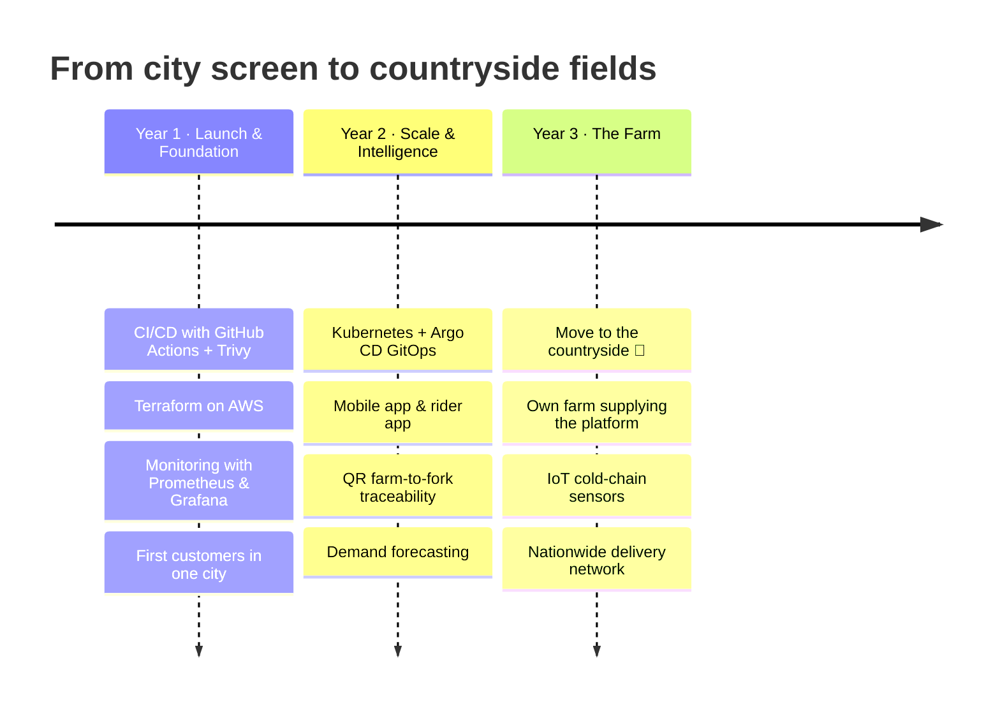

<div align="center">

# 🌾 XaninFarm

### *Safe, healthy food, from the soil to every doorstep in the country.*


🌐 **[xaninfarms.com](https://xaninfarms.com)** · *designed, developed, and engineered by one person*

</div>

---

## 🎬 The Story

> ### *FADE IN.*

**EXT. A CITY THAT NEVER SLEEPS · NIGHT**

Neon on wet streets. Somewhere above them, in a small room, one screen glows.

A DevOps engineer sits in front of it. By day, the job is keeping other people's systems alive: pipelines, clusters, servers that must never go down. The engineer is good at it.

But tonight isn't for anyone else.

Tonight, the first line of a dream is being typed.

---

**INT. THE SAME ROOM · WEEKS LATER**

Coffee gone cold. Error messages scroll past. Migrations fail, then pass. Models are written, broken, and rewritten. *Batches. Expiry dates. Delivery zones. Payment gateways.*

No team. No investors. No one to hand the hard parts to.

Just one person, one keyboard, and one question that refuses to go away:

> ***"Why is it so hard to know whether the food on your plate is safe?"***

Every week, the work continues and the app gets a little better. Every week the skeleton grows stronger.

---

**EXT. COUNTRYSIDE · DAWN · THREE YEARS FROM NOW**

Mist over green fields. A rooster somewhere. The soft hum of a laptop on a wooden table, under a tin roof.

The same engineer, but the city is far behind now. Muddy boots by the door. Hands that know both the soil and the terminal.

On the screen, an order comes in from the far side of the country. A batch of fresh produce is picked, packed, and labeled with the date it was harvested. A rider is on the way.

The engineer built the system that carries it.

The farmer grows the food that fills it.

*They are the same person.*

> ### *This is XaninFarm.*
> *Not just an app. A promise: **safe and healthy food for everyone, everywhere in the country.***

> ### *FADE TO: THE CODE.*

---

## 📖 Table of Contents

1. [The Mission](#-the-mission)
2. [Where It Stands Today](#-where-it-stands-today)
3. [Feature Tour](#-feature-tour)
4. [Architecture Today](#%EF%B8%8F-architecture-today)
5. [Engineering Highlights](#-engineering-highlights)
6. [Tech Stack](#-tech-stack)
7. [Project Structure](#-project-structure)
8. [Quick Start](#-quick-start)
9. [The Future: Where XaninFarm Is Going](#-the-future-where-xaninfarm-is-going)
10. [The Three-Year Roadmap](#%EF%B8%8F-the-three-year-roadmap)
11. [Design × Develop × DevOps](#-design--develop--devops)

---

## 🎯 The Mission

| | |
|---|---|
| 🥬 **Safe food** | Every product is tracked by batch, with production and expiry dates. Nothing expired can ever be sold. |
| 💚 **Healthy food** | Fresh, farm-sourced produce with full information, chosen for quality rather than shelf life |
| 🚚 **Nationwide** | Delivery zones, time slots, and riders designed to scale from one city to the whole country |
| 🤝 **Trust** | Transparent order tracking, verified reviews, and local payment methods people already use |

---

## 📍 Where It Stands Today

> **🏗️ Status: the core platform is built and runs end to end in Docker. It is being refined every week before launch.**

| Metric | Value |
|---|---|
| 🧩 Django apps (bounded domains) | **12** |
| 🗃️ Data models | **~40** |
| 🐍 Lines of Python (excluding migrations) | **~13,500** |
| 🖼️ Templates (storefront, dashboard, emails) | **70** |
| 💳 Payment providers | **5** (bKash, Nagad, SSLCommerz, cash on delivery, mock) |
| ⏰ Scheduled background jobs | **9** Celery tasks |
| 🐳 Production containers | **6** services |
| 👤 People who built it | **1** |

### ✅ Running today vs 🔮 coming next

| Area | ✅ Running today | 🔮 Coming next |
|---|---|---|
| **Storefront** | Catalog, variants, cart, wishlist, coupons, reviews | Mobile app, personalized recommendations |
| **Inventory** | Batch-tracked, expiry-aware, sells oldest-expiry-first | IoT cold-storage sensors, demand forecasting |
| **Orders** | 9-stage lifecycle with an event timeline | Live rider tracking on a map |
| **Payments** | bKash · Nagad · SSLCommerz · cash on delivery | Subscriptions ("weekly vegetable box") |
| **Delivery** | Zones, fees, slots, daily capacity, riders | Route optimization, rider mobile app |
| **Operations** | Staff dashboard, analytics, email alerts | BI dashboards, SMS and WhatsApp alerts |
| **Infrastructure** | Docker Compose, Nginx TLS, health checks | Kubernetes, Terraform, GitOps, observability |
| **Trust** | Batch numbers and harvest dates | 🌱 **QR farm-to-fork traceability** on every pack |

---

## 🌟 Feature Tour

<details open>
<summary><b>🛒 Storefront</b></summary>

- Categories, products, **variants** (weight and pack size), and image galleries
- Cart and **wishlist**
- **Coupons** with discount types, scope rules, and redemption tracking
- **Moderated reviews**, so only approved reviews are shown
- SEO-ready pages, **sitemaps**, a hero slider, promo banners, and testimonials
- A fast, modern UI built with **HTMX + Tailwind CSS**, with no heavy JavaScript framework

</details>

<details open>
<summary><b>📦 Inventory built for perishable food</b></summary>

- Every unit of stock belongs to a **batch** with a batch number, production date, received date, **expiry date**, supplier, unit cost, and storage location
- **FEFO allocation (First-Expired, First-Out):** the batch closest to expiry is always sold first
- **Race-safe stock locking:** batches are locked (`SELECT … FOR UPDATE`) in a fixed order, so two customers can never buy the same last item
- **Stock reservations:** stock is held while a customer pays, then released automatically if they don't
- A full **stock-movement ledger** recording every change, who made it, and why
- An **hourly job retires expired batches** so expired food can never be allocated to an order

</details>

<details open>
<summary><b>🧾 Orders</b></summary>



Each step is recorded as an **order event**, giving customers and staff a complete timeline.

</details>

<details open>
<summary><b>💳 Payments for Bangladesh</b></summary>

| Provider | Type |
|---|---|
| **bKash** | Mobile wallet |
| **Nagad** | Mobile wallet |
| **SSLCommerz** | Cards and online banking |
| **Cash on delivery** | Collected by the rider and recorded in the system |
| **Mock** | Fake payments for development and testing |

- A **pluggable provider registry**: add a new gateway without touching the order logic
- **Webhook event log** and **refund** support
- **Privacy by design**: only masked details are stored (for example `bKash 01XXXXXX789`)
- Multiple attempts per order: a failed bKash attempt followed by a successful one is tracked correctly

</details>

<details open>
<summary><b>🚚 Delivery</b></summary>

- **Delivery zones** by district, area, and postcode, each with its own fee, free-delivery threshold, minimum order, delivery estimate, and cash-on-delivery availability
- **Delivery slots** with order cutoff times and a **daily capacity limit**
- **Delivery partners** (riders) with vehicles and assigned zones

</details>

<details open>
<summary><b>📊 Staff dashboard and automation</b></summary>

- Dashboard pages for **analytics, orders, inventory, batch receiving, customers, payments, and reviews**
- **Daily sales snapshots** for fast analytics
- **Automatic emails:** welcome, order confirmation, order status updates
- **Morning digests for the farm team:** low-stock and expiry alerts
- A **REST API** (Django REST Framework, token authentication) for products, cart, orders, and reviews, ready for a future mobile app

</details>

---

## 🏗️ Architecture Today



### ⏰ Scheduled jobs (Celery Beat)

| Job | Schedule | Why it matters |
|---|---|---|
| 🗑️ Retire expired batches | Hourly | Expired food can **never** be sold |
| 🔓 Release unpaid reservations | Every 10 minutes | Stock held by abandoned checkouts returns to sale |
| 📉 Low-stock digest | Daily at 07:30 | The farm team knows what to restock before the day starts |
| ⏳ Expiry digest | Daily | Sell or discount items before they expire |
| 📈 Sales snapshots | Daily | Fast analytics without heavy queries |

---

## 🔧 Engineering Highlights

| Area | What's done, and why it's production-grade |
|---|---|
| 🐳 **Container image** | Multi-stage build: Node compiles Tailwind, and the runtime image ships without Node |
| 👤 **Least privilege** | Runs as a **non-root user** (UID 1001) |
| 🩺 **Health checks** | The container health check calls a view **that also checks the database**, so an unhealthy app takes no traffic |
| 🔒 **Network isolation** | PostgreSQL and Redis are **never published**; only the internal Compose network can reach them |
| 🔐 **TLS and headers** | Nginx with Let's Encrypt, HTTP → HTTPS redirect, HTTP/2, **1-year HSTS**, secure and HttpOnly cookies |
| 🧩 **Settings per environment** | Separate `dev`, `test`, and `prod` settings; every secret comes from the environment |
| 📦 **Pinned dependencies** | Split `base`, `dev`, and `prod` requirement files |
| 🧪 **Code quality** | `pytest` and `ruff` configured |
| 🚨 **Error tracking** | Sentry, enabled with a single environment variable |
| 🪟 **Windows-friendly** | The entrypoint strips CRLF line endings, a subtle cross-platform bug fixed at build time |

---

## 🧰 Tech Stack

| Layer | Technology |
|---|---|
| **Backend** | Python 3.12, Django 5.1, Django REST Framework, django-filter |
| **Frontend** | HTMX, Tailwind CSS, Django templates |
| **Database** | PostgreSQL 16 |
| **Cache and queue** | Redis 7, Celery 5.4, django-celery-beat |
| **Serving** | Gunicorn, Nginx, WhiteNoise |
| **Infrastructure** | Docker (multi-stage), Docker Compose, Let's Encrypt / Certbot |
| **Payments** | bKash, Nagad, SSLCommerz, cash on delivery |
| **Observability** | Sentry (optional), structured access logs |
| **Dev tooling** | pytest, ruff, MailHog (local email inbox) |

---

## 📁 Project Structure

```text
XaninFarm/
├── apps/
│   ├── accounts/        # 👤 Users & addresses
│   ├── products/        # 🥬 Categories, products, variants, images
│   ├── inventory/       # 📦 Batches, FEFO allocation, reservations, stock ledger
│   ├── cart/            # 🛒 Cart & wishlist
│   ├── orders/          # 🧾 Orders, items, lifecycle events
│   ├── payments/        # 💳 Provider registry: bKash, Nagad, SSLCommerz, COD
│   ├── delivery/        # 🚚 Zones, slots, riders
│   ├── coupons/         # 🎟️ Discounts & redemptions
│   ├── reviews/         # ⭐ Moderated reviews
│   ├── notifications/   # 📧 Emails & digests (Celery)
│   ├── analytics/       # 📊 Daily sales snapshots
│   └── core/            # 🧱 Site settings, pages, SEO, shared models
├── config/
│   ├── settings/        # base · dev · test · prod
│   ├── celery.py        # ⏰ Beat schedule
│   └── api_urls.py      # 🔌 REST API
├── templates/           # 🖼️ Storefront, dashboard, emails
├── nginx/               # 🌐 TLS site config
├── docker/              # 🐳 Entrypoint
├── Dockerfile           # Multi-stage, non-root, health-checked
├── docker-compose.yml       # Development stack
└── docker-compose.prod.yml  # Production stack
```

---

## 🚀 Quick Start

### Local development (Docker)

```bash
git clone https://github.com/abirall/XaninFarm.git
cd XaninFarm

docker compose build
docker compose run --rm web python manage.py makemigrations
docker compose up
```

In a second terminal, create an admin account:

```bash
docker compose exec web python manage.py createsuperuser
```

| Service | URL |
|---|---|
| 🛒 Shop | http://localhost:8000 |
| 👩‍💼 Staff dashboard | http://localhost:8000/dashboard/ |
| 📧 Email inbox (MailHog) | http://localhost:8025 |

> No `.env` is needed locally. The development Compose file has safe defaults built in.

### Production

```bash
cp .env.example .env          # set real secrets
docker compose -f docker-compose.prod.yml up -d --build
```

---

## 🔮 The Future: Where XaninFarm Is Going

> *Today, XaninFarm is a strong skeleton. Tomorrow, it's a nervous system for safe food, connecting farms, warehouses, riders, and families across the country.*

### 🏛️ Target architecture



### 🌱 The opportunity: big ideas the current design already supports

| Opportunity | Why it's realistic | Impact |
|---|---|---|
| 🔍 **Farm-to-fork QR traceability** | Every batch already stores a batch number, production date, supplier, and expiry date | A customer scans a pack and sees **which farm, which day, and how fresh it is** |
| 📦 **Weekly subscription boxes** | Orders, delivery slots, and payment providers already exist | Recurring revenue and predictable harvest planning |
| 🤖 **Demand forecasting** | Daily sales snapshots already collect the data | Harvest only what will sell, so **less food is wasted** |
| 🌡️ **Cold-chain monitoring** | Batches already have storage locations | Sensors alert staff before produce spoils |
| 🧑‍🌾 **Farmer marketplace** | Suppliers are already attached to batches | Fair prices for rural farmers and more variety for customers |
| 🗺️ **Smart delivery routing** | Zones, slots, and daily capacity already exist | Faster delivery and lower fuel cost |
| 📱 **Mobile apps** | A REST API with token authentication already exists | Customer and rider apps on the same backend |

---

## 🗺️ The Three-Year Roadmap



### 🛠️ DevOps journey: from today to fully automated

| Stage | Today | Next |
|---|---|---|
| **Build** | Multi-stage Dockerfile | Image signing (Cosign) and an SBOM |
| **Test** | pytest and ruff configured | CI on every pull request, with a coverage gate |
| **Security** | Non-root user, HSTS, isolated database | Trivy, CodeQL, Dependabot, secret scanning |
| **Infrastructure** | Single-host Docker Compose | **Terraform** for the AWS network, EKS, RDS, ElastiCache, and S3 |
| **Delivery** | Manual `docker compose up` | **Argo CD GitOps** with canary releases |
| **Secrets** | `.env` file | AWS Secrets Manager through External Secrets |
| **Observability** | Logs and optional Sentry | Prometheus, Grafana, Loki, SLOs, and alerting |
| **Reliability** | One server | Multi-AZ, autoscaling, automated backups and tested restores |

---

## 🎨 Design × Develop × DevOps

XaninFarm brings together the three skills its builder has spent a career collecting:

| | Role | In XaninFarm |
|---|---|---|
| 🎨 | **Design** | A trained UX/UI designer: a clean storefront, a clear staff dashboard, and readable emails |
| 💻 | **Develop** | 12 well-separated domains, race-safe inventory, and a pluggable payment architecture |
| ⚙️ | **DevOps** | Containerized, health-checked, and TLS-secured, with a clear path to Kubernetes, Terraform, and GitOps |

> *Most products need three people to design, build, and run them. This one started with one.*

---

<div align="center">

### 🌾 *"Safe and healthy food, for every home in the country."*

**Built with patience, late nights, and a dream, by [Abir Al Zubayer](https://github.com/abirall)**

DevOps & Cloud Platform Engineer · Future Farmer 🌱

[🌐 alzubayer.com](https://alzubayer.com) · [💼 LinkedIn](https://www.linkedin.com/in/abir-al-zubayer/) · [✍️ Medium](https://medium.com/@abirall)

⭐ *If this story moved you, give the repo a star. Every star waters the seed.*

</div>
